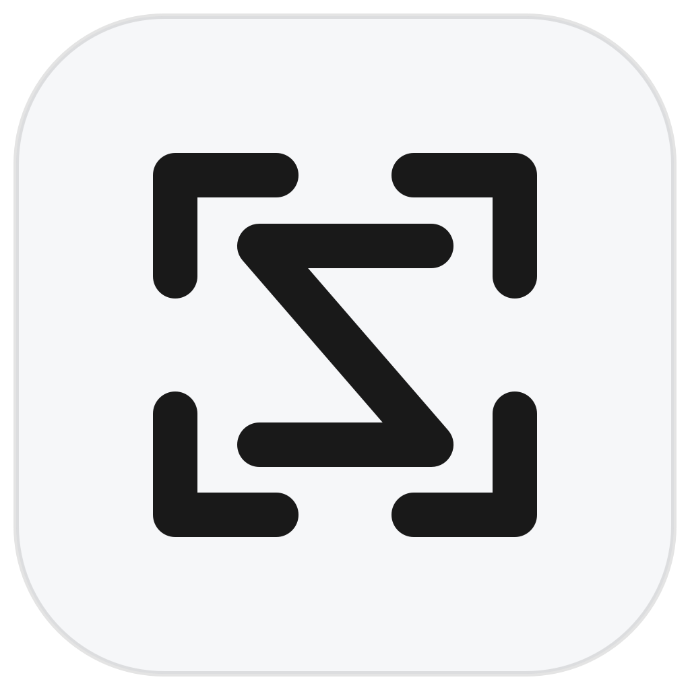

<div align="center">

**简体中文** · [English](README.en.md)



# SnapLex

### 截图、标注、贴图与划词翻译，一套顺手完成

一款为 macOS 打造的原生效率工具。把屏幕内容快速变成可编辑、可查阅、可继续使用的信息。

[功能一览](#功能一览) · [安装与运行](#安装与运行) · [权限说明](#权限说明) · [隐私](#隐私) · [参与开发](#参与开发)

[](https://www.apple.com/macos/)
[](https://swift.org/)
[](https://github.com/BothSavage/SnapLex/actions/workflows/ci.yml)
[](LICENSE)

</div>

SnapLex 将屏幕捕捉和语言学习工具放在同一个原生 macOS 应用中：截取并标注屏幕、把参考内容钉在桌面、录制操作过程，或选中陌生文本立即查看翻译。翻译记录、词频统计和截图历史也都可以在应用主页中管理。

## 功能一览

### 屏幕捕捉与标注

- 区域截图支持窗口识别、选区调整、取色、放大镜和标注。
- 标注工具包括形状、箭头、画笔、马赛克、模糊、序号和文字；标注后仍可移动、缩放和旋转。
- 使用 Apple Vision 分离主体或虚化背景，并可识别截图中的文字和二维码、条形码。
- 滚动长截图支持边滚动边拼接；完成后可继续编辑、复制或贴图。

### 桌面贴图与屏幕录制

- 将截图、剪贴板图片或文字钉在桌面上，方便对照资料；支持缩放、透明度和鼠标穿透。
- 使用 ScreenCaptureKit 录制区域、窗口或整个屏幕，并导出 MP4 或 GIF。
- 最近截图会自动保存到截图历史，可按设置的数量保留和清理。

### 划词翻译与学习记录

- 在其他应用中选中文字后呼出翻译控制条，也可用快捷键触发。
- 可选择 Google 翻译或 macOS 提供的 Apple 原生翻译。
- 通过 macOS 系统词典查看释义，支持朗读英文原词。
- 自动收集划词与截图翻译记录；按日期查看翻译趋势、词频和单词上下文，也可设置忽略词。

### 偏好设置

- 支持简体中文、繁体中文、English、日语、韩语、法语和德语界面。
- 可自定义全局快捷键、设置登录时启动，并分别控制两类翻译是否写入记录。
- 应用内可检查 GitHub Releases 上的最新正式版并查看版本说明；用户从发布页确认下载和安装，不会静默覆盖应用。

## 安装与运行

### 下载

正式版发布后，可从 [GitHub Releases](https://github.com/BothSavage/SnapLex/releases/latest) 下载 macOS 安装包。

SnapLex 使用固定的自签名证书保持应用更新时的 macOS 权限身份。当前 ad-hoc 签名的 1.0.4 升级到固定证书版本时，系统可能要求重新授权一次；之后使用同一证书发布的版本通常可保留现有授权。**1.0.5 和 1.0.6 存在启动崩溃，请手动下载 1.0.7 或更新版本。**这两个版本无法启动内置更新。自签名证书不提供 Apple 公证，因此首次打开时 macOS 可能阻止运行。确认应用来自可信的 SnapLex 发布页后，将 `SnapLex.app` 放入「应用程序」，在终端执行：

```bash
sudo xattr -rd com.apple.quarantine /Applications/SnapLex.app
```

系统提示输入的是当前 Mac 用户的管理员密码。**输入密码时终端不会显示任何字符，也不会显示星号；直接输入完成后按回车即可。** 如果应用不在「应用程序」文件夹，请改为实际路径，例如 `~/Downloads/SnapLex.app`；也可以输入 `sudo xattr -rd com.apple.quarantine `（末尾保留空格），再将应用图标拖入终端并按回车。

### 从源码构建

需要 macOS 15 或更新版本，以及 Swift 5.10+。安装 Xcode Command Line Tools 后运行：

```bash
git clone https://github.com/BothSavage/SnapLex.git
cd SnapLex
./scripts/build_app.sh
open ./dist/SnapLex.app
```

## 权限说明

SnapLex 启动时会检查所需权限；缺少权限时会显示引导，也可以随时在「偏好设置 → 权限设置」中查看。点击对应项目后，按系统提示授权或在系统设置中打开 SnapLex 的开关。返回应用后状态会自动刷新，部分权限可能需要重启应用。

- **屏幕录制与系统声音**：截图、滚动截图、屏幕录制及录制系统声音。
- **辅助功能**：跨应用识别选中文字。
- **输入监控**：跨应用监听选择和录屏按键。
- **麦克风（可选）**：仅在录屏时选择录入麦克风声音后使用，可稍后设置。

## 隐私

截图、截图历史和翻译记录保存在本机。选择 Google 翻译时，待翻译文本会发送给 Google；选择 Apple 原生翻译时，由 macOS 的 Translation 框架处理。应用不会把这些内容上传到 SnapLex 自有服务器。你可以在偏好设置中分别关闭划词翻译和截图翻译的自动记录。

## 参与开发

欢迎提交问题反馈和改进建议。固定签名证书与 GitHub Actions 发布配置见 [RELEASING.md](RELEASING.md)。

## 开源协议

SnapLex 使用 [MIT License](LICENSE)。
